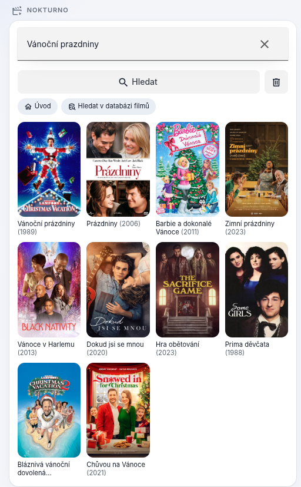
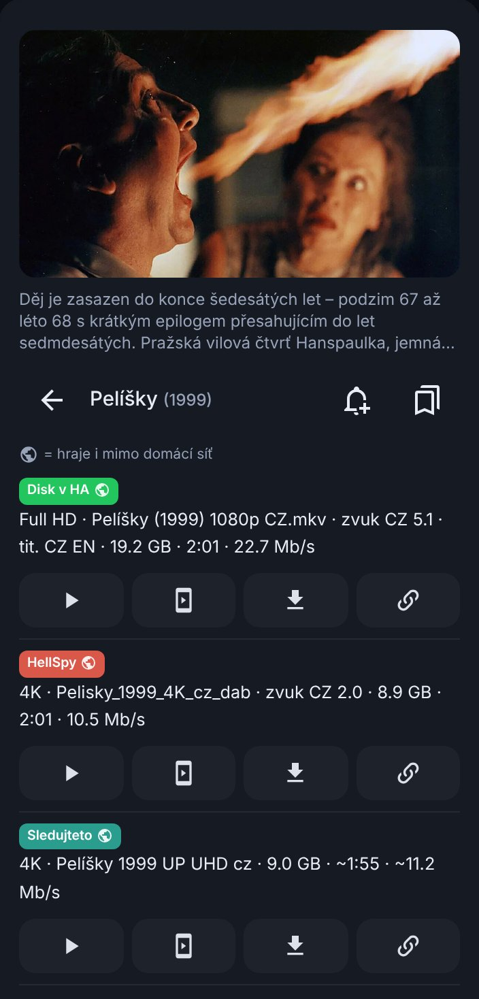
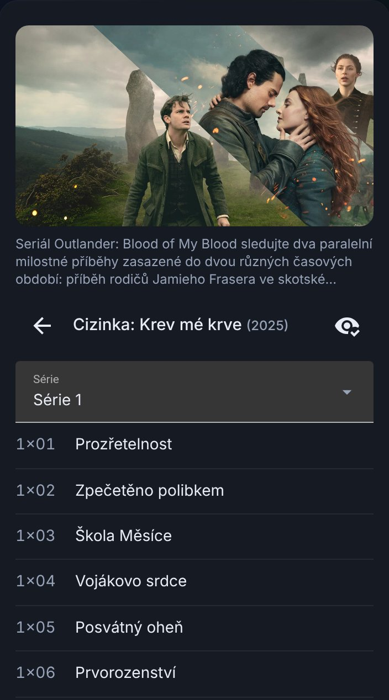

# Používání

## Karta na dashboardu

Nahoře je vyhledávací pole s tlačítkem **Hledat** – jedno hledání pro filmy i seriály ve všech nastavených zdrojích. Pod ním jsou poslední dotazy (klepnutím se hledání zopakuje, křížkem se historie smaže) a pod nimi vodorovné řady plakátů:

- **Pokračovat ve sledování** – rozkoukané filmy a seriály ze všech Kodi. Karta si pamatuje poslední známý stav, takže nezůstane prázdná, když zrovna žádné Kodi neběží.
- **Hlídané** – hlídané seriály a tituly. Plakát titulu, který zatím nemá stream, je ztlumený, u hlídaného dílu je na plakátu číslo dílu (1x02) nebo štítek **nový díl**. Stav (lze pustit, kontrolovat dál, hlídá se, zatím ne) je v dialogu titulu, viz [Hlídané](#hlidane) níž.
- **Můj seznam** – uložené tituly, sdílené s Kodi.
- **Katalogy** – tituly vlastních katalogů s ověřováním streamů. Nad plakáty jsou tlačítka s názvy katalogů, klepnutím se přepíná, který se ukáže. Ve výchozím stavu jsou vidět jen tituly, které mají stream. Katalogy se zakládají v Kodi a do Home Assistantu přijdou synchronizací, v kartě jsou jen vidět; jak je nastavit, viz [Vlastní katalogy](../../cs/vlastni-katalogy.md).
- **Stažené** – probíhající stahování a hotové soubory ve výpisu úplně dole. Probíhající stahování se ukazuje s průběhem.

Řady **Pokračovat ve sledování** a **Hlídané** ukážou 12 titulů, **Můj seznam** 20, zbytek je za dlaždicí **Zobrazit vše**. **Katalogy** ukážou nejvýš 50 titulů. Prázdná řada se nezobrazí (Katalogy zmizí, jen když nejsou založené žádné). Na plakátu je vpravo nahoře hodnocení. Které řady se ukážou a v jakém pořadí, nastavíš v editoru karty (**Sekce a jejich pořadí (řady plakátů)**); volba **V katalozích jen dostupné** určuje, jestli Katalogy ukazují jen tituly se streamem.

**Dialog titulu.** Klepnutí na plakát (v řadě, ve výsledcích hledání, v Katalozích i ve výsledcích z databáze filmů) otevře dialog titulu: název, rok, hodnocení, délka, žánry a celý popis. Dole jsou volby, které se liší podle řady:

- **Vybrat stream** (u seriálu **Otevřít**) – načte streamy, viz níže.
- **Přidat do Mého seznamu** / **Odebrat z Mého seznamu**.
- **Přidat do Hlídaných** / **Odebrat z Hlídaných**, u seriálu **Hlídat nové díly** / **Přestat hlídat**.
- v řadě Pokračovat ve sledování **Odebrat z Pokračovat ve sledování** (jen u titulu rozkoukaného v Kodi).
- v řadě Hlídané u seriálu **Označit nový díl jako viděný** a **Kontrolovat dál díl 1x02 (streamy nevyhovují)**, u titulu se streamy **Přesunout do Mého seznamu** (jen když není označený **Kontrolovat dál**) a **Kontrolovat dál (streamy nevyhovují)**.

Volby, které titul ze seznamu odebírají nebo hlídání ruší, jsou červené. Po zvolení **Vybrat stream** / **Otevřít** (nebo po klepnutí na plakát při zapnutém **Klik na plakát rovnou přehraje**) plakát ztmavne; u filmu ukazuje průběh hledání streamů v procentech.

## Hledání a detail titulu

Po zadání dotazu a klepnutí na **Hledat** se ukáže mřížka plakátů; klepnutím na plakát se otevře dialog titulu. Když hledání najde filmy i seriály, přepínač nabídne obě skupiny zvlášť.

Nad výsledky je tlačítko **Hledat v databázi filmů** (IMDb/TMDB) – najde i tituly, které zdroje nemají. Výsledky se ukážou stejně jako ostatní a klepnutím na plakát se otevře dialog titulu; **Přidat do Hlídaných** a **Přidat do Mého seznamu** jsou v něm mezi volbami. Tlačítko **Zpět k výsledkům ze zdrojů** vrátí původní výsledky.

Otevřením filmu se načtou streamy, u seriálu nejdřív seznam dílů:

 

- Nahoře plakát, pozadí a popis. V hlavičce jsou tlačítka **Přidat do Hlídaných** (zvonek), **Přidat do Mého seznamu** (záložka), u rozkoukaného titulu **Odebrat z Pokračovat ve sledování** a u titulu se streamy v nechtěné kvalitě **vlaječka Kontrolovat dál**.
- U seriálu se nejdřív vybírá díl; v hlavičce seznamu dílů je **Hlídat nové díly** (oko).
- Barevný štítek u streamu říká, odkud stream je. Ikona zeměkoule = stream hraje i mimo domácí síť.
- U každého streamu jsou tlačítka **Přehrát**, **Poslat do mobilu**, **Stáhnout** a **Zkopírovat odkaz**.

### Přehrát

Titul se pustí v Kodi přes doplněk Nokturno, takže si Kodi vede rozkoukanost. Když máš v editoru karty nastavený **Výchozí přehrávač**, tlačítko Přehrát pustí titul hned na něm a seznam přehrávačů nabídne dlouhý stisk. Jinak, když máš v [Nastavení](nastaveni.md#prehravani) víc přehrávačů, karta se podle volby **Přehrávání při více přehrávačích** buď zeptá, kde přehrát, nebo pustí na prvním v seznamu a výběr nabídne na dlouhý stisk tlačítka Přehrát. Přehraje se vždy přesně ten stream, na který klepneš.

### Klik na plakát rovnou přehraje

V editoru karty jde zapnout **Klik na plakát rovnou přehraje (dlouhý stisk = nabídka)** (`auto_play: true`). Klepnutí na plakát filmu pak neotevře dialog titulu, ale rovnou pustí na výchozím (nebo prvním) přehrávači stream, který splní všechny předvolby z [Nastavení](nastaveni.md#prehravani) – jazyk zvuku, 5.1, bez SD a strop datového toku. Když žádný stream nesplní všechno, ukáže se seznam streamů a vybereš sám.

- Řada **Pokračovat ve sledování** pustí stejný stream jako minule, takže Kodi naváže tam, kde přestalo. Bez této volby klepnutí na rozkoukaný titul otevře dialog titulu a stream vybereš v něm.
- U seriálu se otevře seznam dílů.
- Dialog titulu (Můj seznam, Hlídané, Vybrat stream) otevře dlouhý stisk plakátu.

### Když automatické hledání nestačí

Dole v seznamu streamů je tlačítko **Zkusit fulltext na …** (vyjmenuje zapnuté fulltextové zdroje – WebShare, HellSpy, Sledujteto, FastShare, Přehraj.to). Spustí uvolněnější hledání, které najde i soubory s neobvyklým názvem. Takové výsledky mají u sebe otazník – jde o neověřenou shodu, jestli soubor k titulu patří, posuď podle názvu.

## Soubory z vlastního úložiště

Když máš v [Nastavení](nastaveni.md#vlastni-uloziste) vyplněné úložiště, soubory, které k titulu patří, jsou v detailu **mezi streamy vždy první**, se **zeleným štítkem** s názvem úložiště. Dál se s nimi pracuje stejně jako s ostatními streamy:

- **Přehrát v Kodi** – Kodi dostane přímý odkaz na soubor i s přihlášením k úložišti. Doplněk v Kodi úložiště nastavené mít nemusí.
- **Přehrát na jiném přehrávači** (TV, Chromecast, prohlížeč), **Poslat do mobilu** a **Zkopírovat odkaz** – soubor jde přes Home Assistant a přehrávač dostane dočasný podepsaný odkaz (platí 12 hodin, do mobilu 24 hodin). Přetáčení funguje, heslo k úložišti z Home Assistantu neodejde.
- **Stáhnout** – stáhne soubor z úložiště do složky pro stahování.

Nový soubor se v úložišti objeví nejpozději do hodiny, viz [Jak připojit vlastní úložiště](../../cs/vlastni-uloziste.md#kdy-doplnek-uvidi-novy-soubor).

## Hlídané

Integrace hlídá na pozadí dvě věci a pošle oznámení, až se dá opravdu dívat:

- **Hlídané seriály** – kontrola každých 6 hodin. Nový díl se ohlásí, až **má stream**, ne jen když byl odvysílaný. Díly bez data vydání se nehlídají (teprve se natáčejí). Když ve zdrojích chybí díly uprostřed série, kontrola zkusí i nejnovější sérii.
- **Hlídané tituly** – vlastní seznam (Watchlist z Trakt.tv je od 10.0 v Mém seznamu). Kontrola jednou denně ohlásí **první nalezený stream** i to, že **přibyl další zdroj** (třeba lepší kvalita nebo další jazyk). Titul, který zatím nikde není, se hlídá, dokud se neobjeví.

**Kontrolovat dál (vlaječka)** – titul nebo díl má streamy, ale ne takové, jaké chceš (třeba bez českých titulků nebo bez 5.1). Označíš ho vlaječkou v detailu titulu nebo volbou **Kontrolovat dál (streamy nevyhovují)** v dialogu titulu a kontrola se ozve, až streamů přibude. U hlídaného seriálu je volba **Kontrolovat dál díl 1x02 (streamy nevyhovují)** pro poslední dostupný díl přímo v dialogu seriálu v řadě Hlídané; pro zrušení slouží **Přestat kontrolovat dál** (u dílu **Přestat kontrolovat díl 1x02**).

U titulu v Hlídaných, který už má streamy (a není označený **Kontrolovat dál**), jde v dialogu titulu zvolit **Přesunout do Mého seznamu** – pak se přestane hlídat.

S [synchronizací](#synchronizace-s-kodi) se Hlídané sdílí s Kodi: kontrolu stačí udělat na jednom zařízení a Home Assistant ohlásí i díl, který našlo Kodi.

Podrobně v nápovědě: [Hlídané: nové díly a Kontrolovat dál](../../cs/hlidane.md).

## Stahování a odkazy do mobilu

**Stáhnout** u streamu stáhne soubor i s titulky do [složky pro stahování](nastaveni.md#stahovani-a-odkazy). Když titulky zrovna nejdou stáhnout, přehrání ani stažení to nezastaví – video se pustí nebo stáhne bez nich. Hotový soubor je ve výpisu **Stažené** dole na kartě i v Media Browseru Home Assistantu. U streamu ze zdroje CZtor, který stažení nepovoluje, tlačítko Stáhnout skončí hláškou „CZtor stažení tohohle streamu nepovoluje.“ **Poslat do mobilu** pošle odkaz přes službu oznámení; mimo domácí síť funguje díky nastavené adrese mimo domácí síť.

## Synchronizace s Kodi

Zhlédnuto, rozkoukaná pozice, **Můj seznam**, historie hledání a Hlídané se sdílí obousměrně s doplňkem pro Kodi. Vedou k tomu dvě cesty, obě jdou používat současně (Nastavení integrace → sekce *Synchronizace s Kodi*):

- **Kodi v domácí síti** – přes klíč (v Kodi: *Nastavení → Synchronizace → Středisko synchronizace: Home Assistant*).
- **Kodi kdekoli** – přes skupinu Dashboardu Nokturna: první Kodi skupinu založí a ukáže kód `NKT-XXXX-XXXX-XXXX-XXXX`, ten zadáš do pole *Kód skupiny*. Home Assistant se stane dalším členem skupiny. Data jsou zašifrovaná a server je nepřečte.

Každý okruh jde vypnout zvlášť. Běží na pozadí, žádná ruční akce není potřeba. Podrobnosti v [Nastavení](nastaveni.md#synchronizace-s-kodi).

## Stav zdrojů

Senzor **Stav zdrojů** ukazuje, které zdroje potřebují zásah (vypršelé předplatné, nespárovaný CZtor, Luna, která neběží…). Hodnota `0` = vše v pořádku. Podrobně na stránce [Služby a senzory](sluzby-a-senzory.md#stav-zdroju).

Pokračuj na [Služby a senzory](sluzby-a-senzory.md), nebo na [Řešení problémů](reseni-problemu.md), pokud něco nefunguje.
