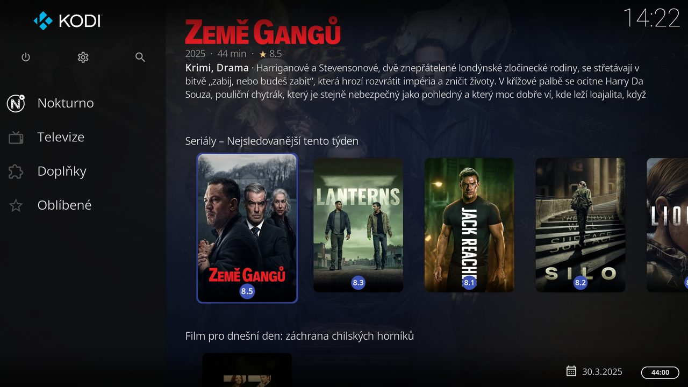

# Vzhľad Estuary Nokturno

**Estuary Nokturno** je vzhľad (skin) pre Kodi postavený na predvolenom Estuary. Nokturno v ňom máš hneď na domovskej obrazovke, bez preklikávania do doplnkov.

## Čo vie

- **Nokturno ako prvá položka hlavnej ponuky.** Hore sú dlaždice ponuky Nokturna (Hľadať, Pokračovať v sledovaní, Sledované, Filmy, Seriály…).
- **Rady s plagátmi**: Pokračovať v sledovaní, Najsledovanejšie filmy a seriály tento týždeň, Môj zoznam, Pre Teba, vlastné katalógy a sezónne katalógy (napríklad Vianoce).
- **Popis vybraného titulu** nad radami – logo alebo názov, rok, dĺžka, hodnotenie a dej.
- Farby Nokturna, zaoblené plagáty, jednotné ikony a modernejšie načítanie a hlásenia.
- Voľba písma: okrem predvoleného aj **Inter** a **Plus Jakarta Sans** (Nastavenia → Rozhranie → Vzhľad → Písma).

## Čo potrebuješ

- **Kodi 21 Omega** (Android TV, CoreELEC, LibreELEC, Windows, Linux).
- **Nokturno 10.14.0 alebo novšie** z Nokturno repozitára. Staršiu verziu si Kodi pri inštalácii vzhľadu aktualizuje samo.

## Inštalácia

1. Nokturno musí byť nainštalované z Nokturno repozitára, pozri [návod na inštaláciu](../navody/kodi/instalace.md).
2. **Nastavenia → Rozhranie → Vzhľad → Vzhľad → Získať ďalšie** a vyber **Estuary Nokturno**.
3. Kodi sa opýta, či vzhľad ponechať – potvrď **Áno**.

## Rady na domovskej obrazovke

Pod ponukou Nokturna sú vždy Pokračovať v sledovaní (keď máš čo dopozerať) a Najsledovanejšie tento týždeň. Ďalšie rady vyberieš v **Nastavenia → Rozhranie → Vzhľad → Nastavenia vzhľadu → Položky hlavnej ponuky → Rady Nokturna na domovskej obrazovke**: Môj zoznam, Pre Teba a vlastné katalógy. Katalógy, ktoré práve ponúkame (napríklad Vianoce), pribudnú samy.

Popis titulu hore sa ukáže, hneď ako prejdeš do radov. Šípkou hore sa vrátiš k dlaždiciam.

## Späť na pôvodný vzhľad

**Nastavenia → Rozhranie → Vzhľad → Vzhľad** a vyber **Estuary**. Nokturno funguje ďalej rovnako, len bez domovskej obrazovky.

## Keď niečo nejde

- **V radoch sa opakuje ponuka Nokturna namiesto plagátov** – máš staršie Nokturno. Aktualizuj doplnok (pozri [Ako zistiť verziu a aktualizovať](aktualizace.md)).
- **Rady sa po štarte Kodi chvíľu načítavajú** – na slabších boxoch to trvá aj desiatky sekúnd, Kodi po štarte spúšťa viac doplnkov naraz.

Vzhľad na GitHube: [github.com/nokturno-app/skin.estuary.nokturno](https://github.com/nokturno-app/skin.estuary.nokturno)
